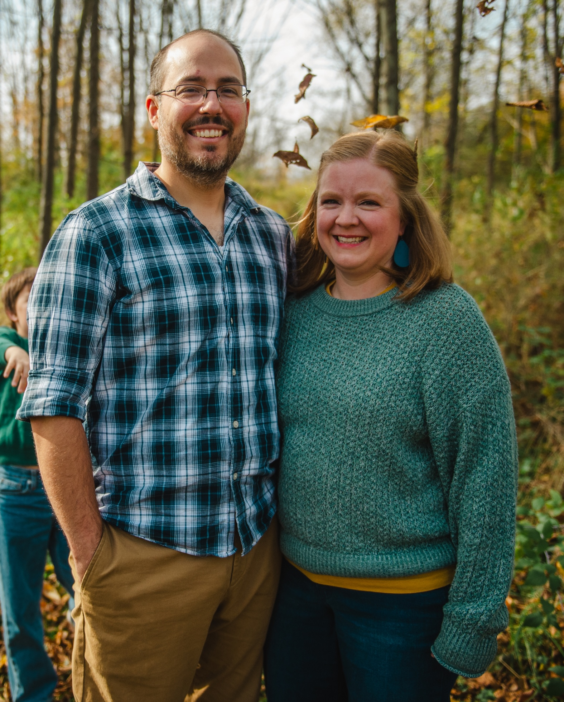

## Who am I?

I am an Associate Teaching Professor in Information Science at
[Cornell University](https://infosci.cornell.edu/) and Director of the Online
Master's Program in Artificial Intelligence (launching fall 2027). I teach
learners data science, data communication, machine learning, and artificial
intelligence.

I enjoy working with individuals from all backgrounds interested in applying
computational methods to extract knowledge and inferences from a wide-range of
domains. I have training and experience in data science and policy evaluation.
In addition to my academic work, I offer consulting services for organizations
interested in data science, including research and analysis as well as tailored
workshops teaching programming skills to your employees.

## More about me

I am originally from Northern Virginia. After graduating from
[James Madison University](https://www.jmu.edu/), I pursued my PhD in political
science from [The Pennsylvania State University](https://www.psu.edu/). I am now
an educator and Associate Teaching Professor at
[Cornell University](https://infosci.cornell.edu/) where I also direct the
Online Master's Program in Artificial Intelligence (launching fall 2027).
Previously I was an Assistant Senior Instructional Professor at the
[University of Chicago](https://macss.uchicago.edu/).

My research focused on state judicial politics and utilized machine learning and
text analysis to analyze agenda-setting behavior on state courts of last resort,
including judicial selection/retention, institutional structure, and case
selection under discretionary jurisdiction.

Since transitioning to the interdisciplinary field of computational social
science, my focus has shifted to developing courses and curricular materials to
integrate programming and computational methods in training in the social
sciences. I teach undergraduate and graduate courses in research design,
programming in R, data visualization, core mathematics, and statistical
learning/computational modeling.

I also offer custom training and research services for companies interested in
learning and implementing data science techniques using R and programmatic
workflows. I am an
[RStudio certified trainer](https://education.rstudio.com/trainers/people/soltoff+benjamin/),
and have experience teaching learners of all different backgrounds how to apply
programmatic techniques to extract knowledge from data. For more information on
the types of services I can offer you, [contact me directly](contact.qmd).

## Personal

##### My amazing wife Amanda

##### Our independent children Jacob, Beverly, Rosemarie

##### Our cute cat Ariel

